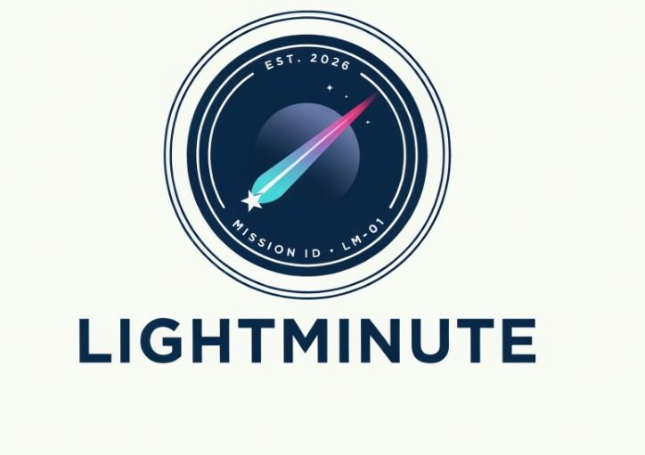
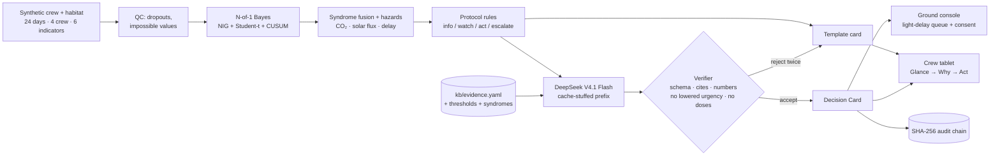

# LIGHTMINUTE
**Your baseline, when Earth is 20 light-minutes away.**



Current design: [Apple HIG inspired workspace and anatomical 3D](docs/native-design.md).
Offline engine, signed data and optional device features: [operation and limitations](docs/supply-chain/OFFLINE-Y-FIRMAS.md).
The optional Bluetooth display handles a real, user-selected pulse reading only in browser memory;
it remains separate from the synthetic scenarios and is not uploaded to the decision engine.
Reference feature audit: [coverage and remaining gaps](docs/reference-coverage.md).

Current verification: [audit and remaining delivery items](docs/ui-audit.md) · [Obsidian connection](docs/Obsidian.md) · [demo runbook](docs/demo-runbook.md).

[](https://www.spaceappschallenge.org/)
[](https://www.spaceappschallenge.org/)
[](#status-what-works-what-is-partial-what-is-missing)
[](#data-and-labels)
[](#safety-and-limits)
[](#stack)
[](#stack)
[](#stack)
[](#stack)
[](#stack)
[-4D6BFE?style=flat-square)](#stack)
[](#tests)
[](#license)

Health-monitoring and decision-support software for astronauts on long missions:
a deterministic N-of-1 Bayesian engine decides, an LLM explains behind a verifier, and the
crew gets cited **Decision Cards** that still work when the model, the link, or both are gone.

> **Synthetic crews. Decision support for trained crew following mission protocols.
> Not a medical device, not a diagnosis.** One real public proxy (MMASH heart rate) and one
> real public space-weather snapshot (NOAA) are labelled and cited; everything else is
> generated by our own simulator. See [`docs/data-card.md`](docs/data-card.md).

---

## What it does

1. **Learns each astronaut's own normal** (per-person Bayesian N-of-1) instead of comparing
   them to a population average — with n=4, the average does not exist.
2. **Adds hazard context** (space weather, cabin environment) without letting it raise an
   alarm on its own.
3. **Reads coordinated shifts**, not just single spikes: several weak signals moving
   together are stronger evidence than one crossing a line.
4. **Produces cited, uncertainty-aware Decision Cards**: what changed, why it matters, what
   to do now, when to escalate, and what to tell Earth given the light delay.

### What makes it different

- **Three lenses side by side** — Earth rule, space-adapted rule, and *your own baseline* —
  with a named pattern when they disagree. At mission day 16 the demo crew member's resting
  HR of 68.5 bpm is *normal* for the population and *unusual for him* (`hidden_in_range`):
  a fixed range stays silent exactly when it matters.
- **Syndrome early warning** with a crew-level view: shared exposure vs individual finding.
- **The LLM never decides.** Numbers and urgency come from the engine; a verifier rejects
  invented citations, invented numbers, diagnosis wording and doses. With
  `LLM_PROVIDER=none` the product still works, with zero network calls.
- **Validated honestly, including where it loses** — and we publish a defect we found in our
  own model on real data (see [Open defect](#open-defect-read-this-before-quoting-numbers)).

### The 90-second demo

Open [`apps/crew-tablet/prototype/three-lens.html`](apps/crew-tablet/prototype/three-lens.html)
(no server, no build, no network). Drag the day slider: days 8–14 are ordinary; at day 15 the
combined score crosses the alert line and at **day 16** the Earth lens says `Normal` while the
personal lens says `Unusual for you`, and the card tells the crew what to re-measure. The data
behind it is real engine output.

---

## Status: what works, what is partial, what is missing

Legend: ✅ works and was exercised · 🟡 works with a stated limit · ⛔ not built.
"Verified by" names the command or check that was actually run on this tree. The current full audit is in `docs/ui-audit.md`; older browser/build size figures below are historical.

### ✅ Working

| Area | What works | Verified by |
|---|---|---|
| **N-of-1 engine** | Per-person conjugate Bayesian baseline (NIG + Student-t), winsorised robust updates, two-sided CUSUM, directional **syndrome** score, three-lens verdicts, crew attribution with 2-day persistence, QC that drops impossible readings before any update | `python scripts/run_tests.py` → **111/111** (nof1, syndrome, lenses, crew/ground/space, pipeline, simulate, qc, verifier, api, llm) |
| **Scenarios** | 3 scripted scenarios × `strong`/`mild`, 24 days, 4 crew with roles (CMO/CDR/MS1/MS2), 6 indicators (`rest_hr`, `temp_c`, `sleep_h`, `pvt_ms`, `co2_ppm`, `headache_score`), sensor dropouts, hazards, deterministic by `(name, variant, seed, days)` | `python scripts/export_demo_json.py --all`; `apps/crew-tablet/public/data/scenario-*.json` + `scenario-index.json` |
| **API** | `GET /api/health`, `GET /api/scenarios`, `GET /api/scenario/{name}`, `POST /api/card`, `GET /api/llm-stats`; scenarios come from `pipeline.run_scenario` when importable, else the static JSON; CORS restricted to localhost | uvicorn smoke: `/api/scenario/cmo_fever` → `source: engine`, 24 days, 6 indicators; `POST /api/card` day 15 crew A → `level: act`, `card_source: template` |
| **Decision Cards** | One byte-stable system prefix (rules + whole KB + thresholds/syndromes with their status) so DeepSeek disk caching hits; verify → one retry with the error list → deterministic template fallback | `test_llm`: rejection→fallback, retry feeds errors back, prefix bytes identical across calls, injection stays in the *user* message, `LLM_PROVIDER=none` → zero network |
| **Verifier** | Frozen field set, KB-only citations, numbers checked against engine facts, urgency may only rise, no diagnosis wording, no dose language, 140-char ground message | `test_verifier` + **30/30** adversarial cards rejected (`python -m tether_engine.llm.redteam`) |
| **Crew tablet** | React app: **Glance → Why → Act**; crew strip, body map, personal 95 % band charts for all 6 indicators, Earth rule with its cited status, three-lens cards, syndrome strip, checklist, ground message with budget and reply countdown, protocol runner mounted, dark/light, presentation mode, URL hash state | `npm run build` green (293 kB JS / 92 kB gzip); A3 ran it in a browser with the API **on and off** |
| **Protocol runner** | `mountProtocolRunner(el, {protocolId, onStep, onDone})`; one step per screen, ≥64 px targets, per-step timer, "can't do this" branch (skip / crew mate / escalate), undo, `→ ← C`, ARIA progressbar + live regions, `demo wording` badge with source | Mounted in the tablet and in `packages/protocol-runner/demo.html` (9-step run, undo, cannot-branch exercised) |
| **Protocols** | 3 dose-free protocols (`fever_like_syndrome`, `co2_headache_cluster`, `post_eva_orthostatic`); every unsourced step marked `demo-wording`; steps point at the onboard medical protocol | `kb/protocols/*.json`, badge visible in both mounts |
| **Ground console** | Static, no build: crew levels, sparklines against the personal band, delayed message queue from `ground_message` + `routing`, consent tiers (behavioural off by default), ISS/Moon/Mars light-delay timeline, tamper-evident chain viewer | Browser: 4 crew cards, 16 sparklines, day-15 queue, "symptoms withheld", tamper flagged at entry #1 |
| **Audit chain** | SHA-256 hash chain, same canonical JSON as the Python engine, viewer names the first tampered entry | JS ↔ Python vectors identical, **8/8** (`node apps/ground-console/src/audit.test.mjs`) |
| **Real NOAA snapshot** | `scripts/fetch_noaa.py` writes an immutable snapshot + manifest (url, retrieved_at, sha256, rows, license) and derives `public/data/radiation.json`; `ingest.verify_snapshot()` checks sha256 and row count | Real run 2026-11-14T14:38:16Z, 2 288 rows, S-scale 0 (quiet Sun) |
| **Validation harness** | Four detectors at an equal false-alarm budget, plus interval calibration, missing-reading robustness and baseline-length sensitivity | `python ml/validation/run_all.py` → `docs/validation.md`, `ml/validation/results.json`, `public/data/validation.json` (~2.5 min) |
| **CI** | GitHub Actions on every push to `main`: engine job (78 tests, 30 red-team cases, API smoke with no key) and frontend job (`npm ci` + build, audit vectors, syntax checks) | run 43613134201: both jobs green |

### 🟡 Partial — usable, but read the limit

| Area | Limit |
|---|---|
| **LLM path** | **No live DeepSeek call has ever been executed** (no key in the build environment). Request shape, `response_format: json_object`, effort tiers and cache-hit accounting are implemented but unverified against the real API. Everything is covered by a fake client; templates are always the fallback. |
| **Real-data evidence** | MMASH proxy (22 healthy adults, per-minute HR) tests **interval honesty, not detection**: no labelled events, so no recall or delay can be claimed from it. OSDR / Inspiration4 was processed from the unrestricted OSD-575 CMP table (4 participants, 79/287 postflight values outside preflight bands, exploratory only); literature-direction concordance is NOT DONE. |
| **Mild scenarios** | Deliberately weak: `cmo_fever` mild reaches `act` only on some seeds, `sep_sleep_loss` mild mostly stays `watch`. Do not present mild as "detected". |
| **Radiation panel** | Verified in the production build: archived NOAA flux plot, `real-public` label, retrieval time and source. One day, one satellite; S0. Flux is not absorbed dose and this is not live telemetry. |
| **Validation panels** | Verified with the published JSON: both crew cohorts, four detectors, calibration and missing-data/baseline tables. These are synthetic benchmarks, not clinical validation. |
| **Earth rule in Why** | Read from `kb/thresholds.json` at build time (with its own `earth-standard` / `demo-parameter` status and source), not exported per reading. `pvt_ms` has no cited Earth rule and says so. |
| **Protocol suggestion** | No scenario names a `protocol_id`, so the panel starts at "No protocol" and the crew picks — nothing is auto-invented. |
| **Consent** | Tiers are UI + preview only: there is no signed store-and-forward upload path. |
| **Template wording** | Routine cards now send a routine-monitoring summary. Regression-tested; scenario exports and console fixture regenerated. |
| **`file://`** | The console and protocol demo were tested via `file://` in Chromium. The React tablet requires HTTP serving. |

### ⛔ Missing

- **Repository is private.** Space Apps requires a public repo, so visibility has to be changed before submission.
- Submission assets: the 60-second video, public demo/video URL and team/roles section. Eight screenshots are in `docs/screenshots/`.
- `.github/workflows/ci.yml` runs the tests and the tablet build on every push to `main` and on PRs, it ran green on both jobs on 14-nov (run 43613134201) but never on a public repo, and ownership now includes the vault and passes locally. The expanded CI workflow has not been pushed in this revision.
- OSDR / Inspiration4 data (blocked by 404s), and any prospective validation on real crew data.
- Vision / voice input endpoints, DeepSeek web-search use, production auth and multi-crew sessions remain outside the prototype scope.
- Expert clinical review of thresholds and protocol steps, and regulatory classification work.

### The defect we found and fixed (read this before quoting numbers)

`bayes/nof1.py::update` discounted `kappa` and `beta` with the forgetting factor but **not
`alpha`**, so `df` grew without bound and the predictive interval collapsed. Measured on a flat
healthy series: 100 % coverage at 23 updates, 83 % at 200, 56 % at 500, **16 % at 2 000**; on
MMASH per-minute HR: **21.6 %** (nominal 95 %).

It is fixed on `main`: `alpha` is now discounted toward its prior value, which pins `df` around
52 instead of letting it grow. Re-measured before the FI-13 guard: **100 % / 97 % / 95 % / 95 %**
at those four stream lengths and **93.4 %** on the real MMASH minutes (93.15 % in the preregistered
study). The FI-13 guard now lowers that real-minute coverage to **66.37 %**, a calibration
regression documented in [`ml/proxy/RESULTS.md`](ml/proxy/RESULTS.md). Every table in this
README, in `docs/validation.md` and in the tablet's `validation.json` was regenerated after the
fix, and `tests/test_nof1.py` now fails if coverage collapses again. The old rule stays as
`LegacyUndiscountedBaseline` in `ml/diagnostics/forgetting_drift.py`, so the before/after remains
reproducible. Full write-up: [`docs/model-card.md`](docs/model-card.md).

---

## Stack

| Layer | Technology | Why |
|---|---|---|
| **Engine** | Python 3.11+, `numpy`, `scipy` | Conjugate Bayesian updates with Student-t predictives, CUSUM, directional fusion. No ML framework: at n=4 you need explainability, not parameters. |
| **API** | FastAPI 0.128, uvicorn, Pydantic 2 | Five endpoints, typed bodies, automatic OpenAPI, template cards with `LLM_PROVIDER=none`. |
| **LLM** | DeepSeek **V4.1 Flash** (`deepseek-flash`, OpenAI-compatible) — optional | 1M context + disk caching means the whole cited KB is cache-stuffed in the system prefix: no vector DB, no RAG infra; case data goes last. Effort `high` for cards, `low` with `?fast=1`, `max` for red-teaming. |
| **Crew tablet** | React 19, TypeScript 5.9 (strict), Vite 7 | Typed payloads straight from the data contract; virtual modules inline `kb/protocols` and thresholds at build time. Charts are hand-written SVG — no chart library. |
| **Protocol runner** | TypeScript source, generated ES module and classic script | Framework-free; embeddable in React and openable from `file://`. |
| **Ground console** | TypeScript source, SVG and SubtleCrypto | Generated static browser scripts work offline; the audit chain verifies in the browser. |
| **Data** | JSON scenario exports + `data/synthetic/` + `data/snapshots/` | Deterministic by seed (~350 KB per scenario) so any front end can fall back to a file; immutable snapshots carry sha256 + license. |
| **Knowledge** | `kb/evidence.yaml`, `kb/thresholds.json`, `kb/syndromes.json`, `kb/protocols/` | Every claim cites an id with a `status` (`verified` / `demo-parameter` / `unverified`); nothing unlabelled reaches the UI. |
| **Tooling** | `scripts/run_tests.py` (dependency-free), `node --check`, `make`, `gh` | Tests run with system Python — no pytest install needed. |

### Architecture



---

## Quick start

```bash
cp .env.example .env          # optional: DEEPSEEK_API_KEY; LLM_PROVIDER=none works with no key
python scripts/run_tests.py   # 111/111, no network, no pytest required

# engine + API on :8000
cd services/engine && uvicorn tether_engine.api.main:app --port 8000

# crew tablet (Vite dev server)
cd apps/crew-tablet && npm ci && npm run dev

# ground console (static, no build)
python -m http.server 8130    # -> http://localhost:8130/apps/ground-console/
```

`make dev` starts the API and the tablet together; `make test`, `make validate`
(`ml/validation/run_all.py`) and `make lint` are the other entry points.

### Environment variables

| Variable | Default | Meaning |
|---|---|---|
| `LLM_PROVIDER` | auto | `deepseek` \| `none`. Unset/`auto` = deepseek when a key exists, else none |
| `DEEPSEEK_API_KEY` | — | required for the LLM path; never returned by the API, logged or committed |
| `DEEPSEEK_BASE_URL` | `https://api.deepseek.com` | OpenAI-compatible endpoint |
| `DEEPSEEK_MODEL` | `deepseek-flash` | model id |
| `MISSION_PROFILE` | `mars` | `iss` \| `moon` \| `mars` — light-delay simulation |
| `VITE_API_BASE` | empty | optional absolute API origin for the tablet |

### API

```bash
curl -s localhost:8000/api/health
curl -s localhost:8000/api/scenarios
curl -s localhost:8000/api/scenario/cmo_fever | head -c 300
curl -s -X POST localhost:8000/api/card -H 'Content-Type: application/json' \
     -d '{"scenario":"cmo_fever","crew":"A","day":15}'
curl -s -X POST 'localhost:8000/api/card?fast=1' -H 'Content-Type: application/json' \
     -d '{"scenario":"cmo_fever","crew":"B","day":3}'   # effort low
curl -s localhost:8000/api/llm-stats
```

`POST /api/card` returns
`{card, card_source: "llm"|"template", verifier_errors[], usage{calls,prompt_tokens,completion_tokens,cache_hit_tokens}, provider, effort, attempts, scenario, crew, day, source, synthetic}`.
Every `card` has passed the verifier, so a front end can render it without trusting the model.

### Scenarios

| Name | Onset | Affected | Delay profile | Shows |
|---|---|---|---|---|
| `cmo_fever` | day 15 | crew A (the CMO) | Mars | The medical officer is the patient: the crew must run the protocol without them |
| `sep_sleep_loss` | day 12 | crew C | Moon | Solar particle event + schedule disruption; sleep drops first |
| `co2_creep` | day 8 | all crew | Mars | Shared exposure: fix the habitat before treating anybody |

Each scenario also ships a `mild` variant for honest "we missed it" demos.

---

## Tests

The console, protocol runner, signature scripts and browser tests are maintained as
TypeScript. From `apps/crew-tablet`, `npm run build:static` generates the JavaScript
needed by browsers and Node, and `npm run typecheck:static` checks those sources.
Generated files are identified as such in `.gitattributes`; HTML and CSS remain the
actual markup and styles consumed by the browser. Older standalone simulator and HUD
prototypes still contain inline JavaScript and have not been migrated.

The Bash helpers in `scripts/` support development, not the deployed app:
`check_all.sh` runs the repository checks and validation; `link-skills.sh` copies the
local agent skills to the supported agent directories (replacing matching copies); `setup_worktrees.sh` creates
isolated agent worktrees; and `merge_agents.sh` checks ownership and merges selected
agent branches. Review the last two before running them because they modify Git state.

```bash
python scripts/run_tests.py                       # 111/111 — engine, pipeline, QC, verifier, API, LLM
node apps/ground-console/src/audit.test.mjs       # 8/8 — JS hash chain == Python vectors
PYTHONPATH=services/engine python -m tether_engine.llm.redteam   # 30/30 adversarial cards rejected
cd apps/crew-tablet && npm run build              # tsc -b && vite build
```

None of them touch the network: the LLM path is tested with a fake client.

---

## Validation

At an equal false-alarm budget (~0.10 per crew-week, tuning and report seeds disjoint, 500
synthetic crew per effect size), the directional N-of-1 **syndrome** detector recovers **71 %**
of mild, **96 %** of moderate and **100 %** of strong sustained shifts with a median delay of
~2 days — versus 18 % / 38 % / 91 % for a population threshold. On a heterogeneous crew the gap
widens: 66 % / 93 % / 100 % versus 9 % / 13 % / 27 %.

Additional checks, all synthetic: interval calibration **95 %** pooled coverage of the nominal
95 % band (n = 11 040 indicator-days); syndrome recall degrades 93 % → 84 % → 76 % with 0/20/40 %
of readings missing; recall improves 79 % → 84 % → 93 % with 3/7/14 days of personal history.

Two honest caveats: the syndrome score knows the direction of the clinical prior (it is blind to
other directions), and single-indicator N-of-1 is *not* meaningfully better than a population
rule on homogeneous crews — the gains come from CUSUM, the syndrome score and heterogeneity.
Read the full tables and limitations in [`docs/validation.md`](docs/validation.md) and the
defect section of [`docs/model-card.md`](docs/model-card.md) before quoting any number.

### Data and labels

| Label | What it is |
|---|---|
| **synthetic** | The crew, scenarios and benchmark tables — our own simulator |
| **real-public** | NOAA SWPC GOES proton flux (`public/data/radiation.json`, snapshot with sha256) |
| **proxy** | MMASH 1.0.0 wearable HR, 22 healthy adults (ODbL 1.0, aggregate results only) |

The MMASH run is a coverage test of the same engine code, not a detection result. Before the
FI-13 guard the model covered 93.4 % of real minutes inside the nominal 95 % band (93.15 % in
the preregistered study), and 21.6 % before the `alpha` fix — which is how that defect was found.
With the FI-13 guard the shipped engine covers 66.37 %, below the preregistered 90–98 % tolerance;
that is a shipping blocker, not a detection claim.
OSD-575 was processed from the unrestricted CMP table: 4 participants, 79/287 postflight values
outside preflight bands, exploratory only. Directional concordance with the literature is NOT DONE.

---

## Safety and limits

1. **The engine decides, the LLM explains.** Urgency and numbers come from deterministic code; the model may keep or raise urgency, never lower it.
2. **A verifier sits between the model and the crew.** Unknown citations, invented numbers, diagnosis wording, doses, extra fields or an over-long ground message are rejected; a rejected card is retried once, then replaced by the template.
3. **The product works unplugged.** `LLM_PROVIDER=none` produces template cards with zero network calls.
4. **Everything is labelled.** Synthetic crews say `SYNTHETIC`; thresholds carry `verified` / `earth-standard` / `demo-parameter`; unknown claims say `unverified` instead of guessing.
5. **No diagnosis, no doses.** Cards say "pattern worth checking"; medication steps point at the onboard medical protocol.
6. **Escalation is conservative.** Ambiguity means a higher level plus "re-measure", never a quieter screen.
7. **Context never raises an alarm by itself.** Radiation or cabin readings may change wording, not levels.

## Repository map

```
services/engine/tether_engine/   Bayesian engine, QC, lenses, syndromes, attribution, pipeline, audit, ingest
services/engine/tether_engine/api/          FastAPI app (5 endpoints)
services/engine/tether_engine/llm/          card service, KB prefix, verifier, DeepSeek client, red-team
apps/crew-tablet/                React 19 + TS crew app (Glance → Why → Act) + no-build prototype screen
apps/ground-console/             static flight-surgeon console + browser audit chain
packages/protocol-runner/        framework-free timed protocol runner (ESM + classic build)
packages/ui-kit/                 design tokens
kb/                              cited evidence, thresholds, syndromes, 3 protocols
llm/                             Decision Card prompt + JSON schema
ml/validation · ml/proxy · ml/diagnostics · ml/sensitivity   benchmarks, MMASH run, defect, 24 h term
data/synthetic · data/snapshots  generated sidecars; immutable, checksummed public snapshots
docs/                            architecture, data contract, validation, model card, data card, submission
pitch/                           demo script, slides outline, judge Q&A, project description
vault/                           the team's Obsidian vault (research, ADRs, execution)
handoff/                         per-agent handoff notes
```

## Use of AI

Built with **DeepSeek V4.1 Flash** and coding agents, as disclosed per Space Apps guidance. The
team reviews and owns every modelling decision, threshold and word that reaches the crew; the
model is a swappable explanation layer, never a decision maker.

## License

Apache-2.0 — see [LICENSE](LICENSE).
