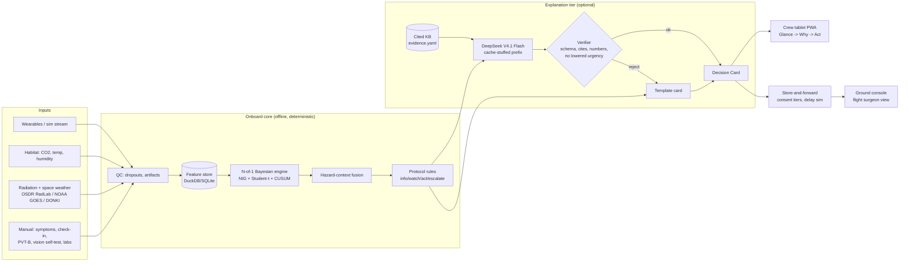

# TETHER — Architecture

> Autonomous medical reasoning for Earth-independent crews. Decision support, **not** a medical device.

## Design decisions (see vault ADRs)
| # | Decision | Reason |
|---|---|---|
| 1 | Engine decides, LLM explains | Safety + validity; works with no LLM |
| 2 | N-of-1 conjugate Bayes (not deep nets) | n=4 crews; explainable; aligned with NASA HRP Artemis II methods |
| 3 | Cache-stuffed KB, no vector DB | DeepSeek 1M ctx + disk cache: ~50x cheaper hits; zero infra |
| 4 | Python engine + TS PWA | Fast to build; schemas shared via JSON Schema |
| 5 | Snapshots + manifest for real data | Hackathon networks fail; reproducible |
| 6 | Template fallback for every card | Demo never dies; honest degraded state |

## Runtime tiers
- **Tier 0 – Onboard core**: ingest -> QC -> engine -> protocols. No network, no LLM.
- **Tier 1 – Explanation**: LLM + verifier produce readable cards. Falls back to templates.
- **Tier 2 – Ground link**: delayed, consent-tiered, signed (stretch). Delay profile: ISS ~0 s, Moon ~1.3 s, Mars 3–22 min one-way.

## Data contracts
- `Reading{crew_id, ts, indicator, value, unit, context, quality, source}`
- `EngineFacts{crew_id, level, numbers{}, indicators[], risk_family, confidence_inputs{n_seen, df}}`
- `DecisionCard` — see `llm/schemas/decision_card.schema.json`
- `GroundMessage{crew_id, tier, payload, created_at, deliver_after}`

## Deployment (hackathon)
Engine on Render/Fly (or local), PWA on Vercel, secrets server-side only. Demo mode serves precomputed scenario JSON when offline.
