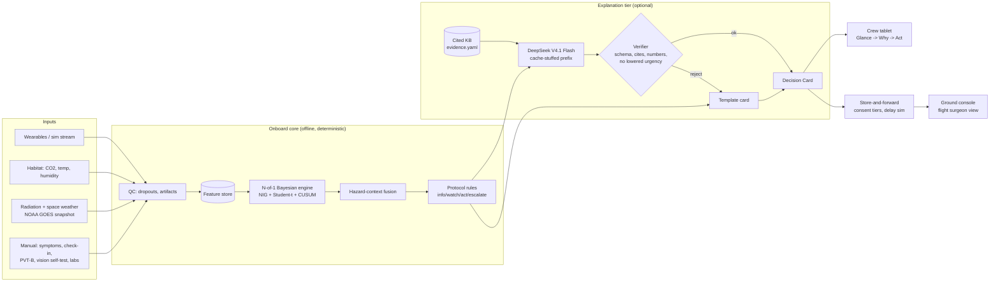

# LIGHTMINUTE — Architecture

> Autonomous medical reasoning for Earth-independent crews. Decision support, **not** a medical device.

## Implementation status (2026-11-14)

| Layer | Component | Status |
|---|---|---|
| Core | N-of-1 baseline (`bayes/nof1.py`), syndrome (`bayes/syndrome.py`) | **Built, tested** — 1 open defect: forgetting `alpha` (see model card) |
| Core | Crew attribution, delay routing, space weather, audit chain | **Built, tested** |
| Core | Three lenses, labelled thresholds, template cards, verifier | **Built, tested** |
| Core | QC (`qc/basic.py`) and scenario pipeline (`pipeline.run_scenario`) | **Built, tested** |
| Core | Synthetic scenarios `cmo_fever` / `sep_sleep_loss` / `co2_creep` (+ mild variants, labels sidecars) | **Built** — exports in `data/synthetic/` |
| Data | NOAA GOES snapshot + panel, MMASH proxy, manifest verification (`ingest/`) | **Built** |
| Data | Validation harness (head-to-head, calibration, missing data, baseline length) | **Built** |
| Explain | LLM client + verifier + prompt/schema | **Built** (client untested against a live key) |
| Explain | Card service, `/api/*`, llm-stats, red-team cases | **Built, tested** (no live key exercised) |
| UI | Reference screen (`prototype/three-lens.html`) | **Built** |
| UI | Tablet app (Glance/Why/Act), radiation and validation views | **Built, tested** — `npm run build` (tsc + vite) |
| Ground | Protocol runner (`packages/protocol-runner`), ground console | **Built** (static, no build step) |

Merged on `main` 2026-11-14; verified on that tree: **76/76 tests**, tablet production build OK,
validation regenerated with identical numbers. The A3/A4 screens were not clicked through —
see `handoff/a6.md`.

## Design decisions (see vault ADRs)
| # | Decision | Reason |
|---|---|---|
| 1 | Engine decides, LLM explains | Safety + validity; works with no LLM |
| 2 | N-of-1 conjugate Bayes (not deep nets) | n=4 crews; explainable; aligned with NASA HRP Artemis II methods |
| 3 | Cache-stuffed KB, no vector DB | DeepSeek 1M context + disk cache; zero infra |
| 4 | Python engine + TS PWA | Fast to build; schemas shared via JSON Schema |
| 5 | Snapshots + manifest for real data | Hackathon networks fail; reproducible |
| 6 | Template fallback for every card | Demo never dies; honest degraded state |
| 7 | Separate baselines per context | Measured: one band spanning sleep and activity has to be very wide (see `ml/proxy/README.md`) |

## Runtime tiers
- **Tier 0 – Onboard core**: ingest → QC → engine → protocols. No network, no LLM.
- **Tier 1 – Explanation**: LLM + verifier produce readable cards; falls back to templates.
- **Tier 2 – Ground link**: delayed, consent-tiered; ISS ~0 s, Moon ~1.3 s, Mars 3–22 min one-way.

## Data contracts
- `Reading{crew_id, ts, indicator, value, unit, context, quality, source}`
- `EngineFacts{crew_id, level, numbers{}, indicators[], risk_family, confidence_inputs{n_seen, df}}`
- `DecisionCard` — `llm/schemas/decision_card.schema.json`
- `GroundMessage{crew_id, tier, payload, created_at, deliver_after}`
- Demo scenario bundle — `docs/DEMO_DATA_CONTRACT.md` (24 days × 4 crew, real engine output)
- **Radiation panel** — `apps/crew-tablet/public/data/radiation.json`:
  `{synthetic, label: real-public|proxy|synthetic, source, source_url, retrieved_at, license,
    channel, satellite, units, points[{ts, flux, s_scale}], current, peak, s_scale_now,
    s_scale_max, thresholds_pfu, why, note}`
- **Validation page data** — `apps/crew-tablet/public/data/validation.json`:
  `{synthetic, label, generated_by, design, scenarios[{id, title, methods[{id, name,
    fa_per_week, recall{mild, moderate, strong}, median_delay_moderate_days}]}],
    calibration{nominal, overall_coverage, n, by_indicator}, missing_data[],
    baseline_length[], limitations[], note}`
- **Snapshots** — `data/snapshots/manifest.json` entries
  `{source, url, retrieved_at, sha256, rows|bytes, license, snapshot, mode}`;
  `tether_engine.ingest.verify_snapshot()` rejects any mismatch.

## Deployment (hackathon)
Engine on a small host (or local), PWA on static hosting, secrets server-side only. Demo mode
serves precomputed scenario JSON when offline. Nothing in the repository requires a running
service: the reference screen and every validation number reproduce from files.
