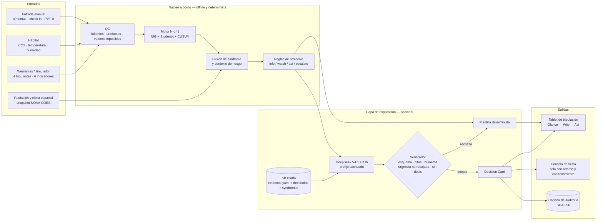
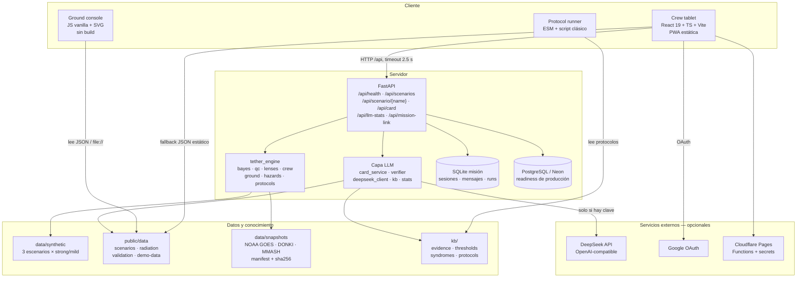
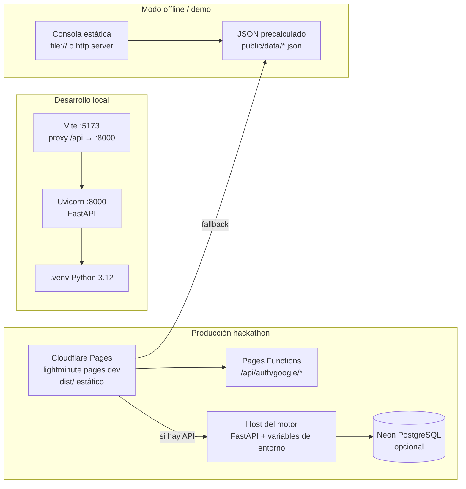

# Avances del proyecto LIGHTMINUTE

> Documento de avance técnico: tecnologías, lenguajes, arquitectura, metodología, requisitos y funcionamiento del aplicativo.
> LIGHTMINUTE es un prototipo de hackathon. Usa datos sintéticos y no es un dispositivo médico.

| Campo | Valor |
|---|---|
| Proyecto | LIGHTMINUTE — monitoreo de salud y soporte de decisiones para tripulaciones espaciales |
| Evento | NASA Space Apps Challenge 2026 — reto “Health Monitoring for Astronauts” |
| Versión documentada | `0.1.0` (motor, tablet y consola) |
| Commit de referencia | `630348d5d453f64d379f5a3b0fd2e463c5b933ec` |
| Rama | `main` |
| Fecha de actualización | 2026-11-14 |
| Estado | Prototipo funcional, offline-first, con QA ejecutado |
| Licencia | Apache-2.0 |

---

## 1. Resumen ejecutivo

LIGHTMINUTE aprende el rango normal de **cada astronauta** con un modelo bayesiano N-of-1, detecta cambios sostenidos con CUSUM y un score de síndrome, y entrega **Decision Cards** citadas con el nivel de urgencia, qué cambió, por qué importa y qué hacer ahora.

La decisión la toma un motor determinista en Python. Un LLM opcional (DeepSeek V4.1 Flash) solo redacta la explicación y pasa por un verificador que rechaza números inventados, citas falsas, diagnósticos, dosis y urgencia rebajada. Si no hay LLM, red o enlace con Tierra, el producto sigue funcionando con plantillas y datos locales.

La interfaz principal es una tablet React con tres vistas — **Glance → Why → Act** — más una consola de tierra para el cirujano de vuelo, una cadena de auditoría SHA-256 y un panel de radiación con datos públicos reales de NOAA.

---

## 2. Tecnologías usadas

### 2.1 Stack por capa

| Capa | Tecnología | Versión observada | Función en el aplicativo |
|---|---|---|---|
| Motor determinista | Python | 3.12.3 | Bayes N-of-1, CUSUM, síndrome, atribución, QC, pipeline, auditoría |
| Cálculo numérico | NumPy | 2.5.4 | Operaciones matriciales y actualizaciones conjugadas |
| Estadística | SciPy | 1.18.1 | Distribuciones, cuantiles y utilidades estadísticas |
| API | FastAPI | 0.163.0 | Endpoints REST tipados, OpenAPI automático, inyección de dependencias |
| Servidor ASGI | Uvicorn | — | Sirve la API en desarrollo y despliegue |
| Validación de datos | Pydantic | 2.14.3 | Esquemas de entrada/salida de la API |
| Cliente LLM | OpenAI SDK (compatible) | 3.51.0 | Llamadas a DeepSeek con formato JSON |
| LLM | DeepSeek V4.1 Flash (`deepseek-flash`) | Opcional | Redacta la explicación de la Decision Card; nunca decide |
| Base de datos de misión | SQLite | Integrado | Sesiones, mensajes y ejecuciones de protocolo del enlace de misión |
| Base de datos de despliegue | PostgreSQL / Neon + psycopg | 3.3.9 | Readiness y conexión de producción para el backend |
| Frontend | React | 19.1.1 | Interfaz de la tablet por componentes y estado |
| Tipado frontend | TypeScript (strict) | 5.9.2 | Contratos tipados entre datos y UI |
| Bundler | Vite | 7.x | Build, dev server, proxy `/api`, módulos virtuales |
| Visualización 3D | Three.js | 0.187.0 | Modelo anatómico GLB con órganos y rotación/zoom |
| Gráficas | SVG escrito a mano | — | Bandas personales, tendencias y flux de protones sin librería de charts |
| Pruebas de navegador | Playwright | 1.65.1 | E2E real contra el build de producción |
| Consola de tierra | JavaScript vanilla + SVG + SubtleCrypto | ES2022 | Vista estática sin build, cadena de auditoría en el navegador |
| Protocol runner | JavaScript vanilla (ESM + script clásico) | ES2022 | Protocolos temporizados, accesibles y embebibles |
| Estilos | CSS con design tokens | — | Tema claro/oscuro, modo rojo nocturno, accesibilidad |
| Datos | JSON, JSON Schema, YAML | — | Escenarios, contratos, KB citada y snapshots |
| Automatización | Make, Bash, GitHub Actions | — | Setup, test, lint, validación y CI |
| Despliegue frontend | Cloudflare Pages + Pages Functions + Wrangler | 4.162.0 | Hosting estático y rutas OAuth del servidor |
| Autenticación | Google OAuth 2.0 + JWT (`jose`) | — | Inicio de sesión opcional; no asigna roles médicos |
| Control de versiones | Git + GitHub | — | Ramas por agente, merges, CI |

### 2.2 Dependencias declaradas y su papel

- **`numpy`, `scipy`**: núcleo matemático del motor. No se usa un framework de deep learning: con cuatro astronautas se prioriza explicabilidad sobre parámetros.
- **`fastapi`, `uvicorn`, `pydantic`**: API de cinco endpoints y contratos tipados.
- **`openai`**: cliente HTTP compatible con DeepSeek; permite cambiar de proveedor sin reescribir la capa de tarjetas.
- **`psycopg`, `python-dotenv`**: conexión server-only a Neon/Postgres y carga de variables de entorno.
- **`duckdb`**: declarada en `pyproject.toml`; el código actual no la usa de forma activa. Se mantiene como dependencia del entorno de análisis.
- **`httpx`**: cliente HTTP para pruebas y llamadas internas.
- **`pytest`, `ruff`, `mypy`**: pruebas, lint y tipado del lado Python.

---

## 3. Lenguajes de programación y propósito

| Lenguaje | Dónde se usa | Propósito | Función concreta |
|---|---|---|---|
| **Python** | `services/engine`, `ml/`, `scripts/` | Motor, API, validación y herramientas | Implementa el motor bayesiano, QC, pipeline de escenarios, verificador, cliente LLM, auditoría, benchmarks y scripts de datos |
| **TypeScript (`.ts`)** | `apps/crew-tablet/src/lib`, `hooks`, `server`, `functions` | Lógica tipada del frontend y del servidor | Acceso a datos con fallback, estado por URL, tipos del contrato, fisiología, OAuth y Pages Functions |
| **TSX (`.tsx`)** | `apps/crew-tablet/src` | Componentes React | Vistas Glance/Why/Act, gráficas SVG, mapa corporal 3D, protocol runner, panel de radiación y validación |
| **JavaScript (`.js`, `.mjs`)** | `apps/ground-console`, `packages/protocol-runner`, scripts E2E | Lógica sin build y pruebas de navegador | Consola de tierra, cadena de auditoría en el navegador, runner de protocolos, smoke tests y E2E |
| **HTML** | `index.html`, prototipos, demos | Estructura de las superficies | Documento único de la PWA, consola, demo del runner y prototipo de tres lentes |
| **CSS** | `styles.css`, `tokens.css` | Presentación y accesibilidad | Tokens de diseño, temas, estados, tamaños táctiles y `prefers-reduced-motion` |
| **JSON** | `data/`, `public/data`, `kb/`, `llm/schemas` | Contratos y datos | Escenarios deterministas, snapshots, KB, validación, radiación y esquema de Decision Card |
| **YAML** | `kb/evidence.yaml` | Base de conocimiento | Afirmaciones citadas con `id`, `source` y `status` |
| **Markdown / Mermaid** | `docs/`, `vault/`, `README.md` | Documentación y diagramas | Arquitectura, model card, data card, validación, runbook y este documento |
| **Bash** | `scripts/*.sh`, `Makefile` | Automatización | Setup, tests, validación, lint, skills y chequeos de gobernanza |
| **SQL** | Esquema embebido de SQLite | Persistencia | Tablas de sesiones, mensajes y ejecuciones del enlace de misión |
| **GLB (binario 3D)** | `organs/*.glb`, `apps/crew-tablet/public/models` | Activos anatómicos | Modelos de órganos para la vista 3D con Three.js |

---

## 4. Arquitectura

### 4.1 Diagrama de contexto



### 4.2 Diagrama de contenedores



### 4.3 Flujo interno del motor

```mermaid
flowchart LR
  A["Lectura cruda\nReading{crew_id, ts, indicator, value, unit}"] --> B["QC\nNaN · imposibles · faltantes · dropouts"]
  B --> C["Baseline N-of-1\nNormal-Inverse-Gamma\nStudent-t predictivo"]
  C --> D["z personal\n+ intervalo 95 %"]
  C --> E["CUSUM bilateral\nk=0.5 · h=4"]
  D --> F["Score de síndrome\ndireccional + covarianza robusta"]
  E --> F
  F --> G["Atribución de tripulación\nindividual vs exposición compartida"]
  G --> H["Reglas de urgencia\ninfo / watch / act / escalate"]
  H --> I["EngineFacts\nnúmeros + nivel + confianza"]
  I --> J["Decision Card\nplantilla o LLM verificado"]
  J --> K["Routing\nISS 0 s · Luna 1.3 s · Marte 3–22 min"]
  K --> L["Cadena de auditoría"]
```



### 4.4 Diagrama de despliegue



### 4.5 Capas de ejecución

| Tier | Qué incluye | Dependencias | Comportamiento si falla |
|---|---|---|---|
| **Tier 0 — Núcleo a bordo** | Ingesta, QC, motor, reglas de protocolo | Ninguna red, ningún LLM | Siempre disponible; es la fuente de verdad |
| **Tier 1 — Explicación** | LLM + verificador + plantilla | Clave DeepSeek opcional | Sin clave o sin red se usa la plantilla |
| **Tier 2 — Enlace con Tierra** | Cola, consentimiento, retardo, auditoría | Red intermitente | Store-and-forward; el retardo depende del perfil de misión |

### 4.6 Decisiones de arquitectura (ADR)

| # | Decisión | Razón |
|---|---|---|
| 1 | El motor decide, el LLM explica | Seguridad y validez; el producto funciona sin LLM |
| 2 | Bayes N-of-1 conjugado, no redes neuronales | n=4; explicabilidad; alineado con métodos de pequeña muestra de NASA HRP |
| 3 | KB cacheada en el prefijo del LLM, sin vector DB | Contexto de 1M tokens y caché de disco; cero infraestructura RAG |
| 4 | Motor Python + PWA TypeScript | Rapidez de desarrollo, pruebas veloces y científicos cómodos en Python |
| 5 | Snapshots inmutables con manifiesto y sha256 | Redes de hackathon fallan; resultados reproducibles |
| 6 | Plantilla de respaldo para toda tarjeta | La demo nunca muere; estado degradado honesto |
| 7 | Baselines separados por contexto | Una sola banda que cubra sueño y actividad tendría que ser demasiado ancha |

---

## 5. Metodología de desarrollo

### 5.1 Enfoque general

El proyecto se construyó como un **prototipo de hackathon de 48 horas** con un enfoque híbrido:

1. **Desarrollo dirigido por evidencia y seguridad**: primero se definieron los riesgos de NASA HRP, las etiquetas de datos y las reglas de seguridad; después se implementaron.
2. **Paralelización por agentes con propiedad de archivos**: siete agentes (A1–A7) trabajaron en worktrees separados. Cada uno solo podía tocar sus rutas declaradas en `agents/OWNERS.json`; los cruces se comunicaban por `handoff/aN.md` y solo el integrador hacía merge.
3. **MoSCoW para control de alcance**: MUST, SHOULD, COULD y WON'T definidos antes de construir. La regla fue congelar funcionalidades en T-4 h.
4. **Pruebas desde el inicio**: el motor, el verificador y los contratos tienen pruebas automatizadas. Cada defecto encontrado se convirtió en una prueba de regresión.
5. **Validación honesta**: se publican las métricas y también los casos donde el modelo pierde. Los escenarios “mild” existen para demostrar fallos, no para inflar resultados.
6. **Documentación como memoria del proyecto**: ADRs, model card, data card, runbook, vault Obsidian y este documento.

### 5.2 Fases de trabajo

| Fase | Actividad | Resultado |
|---|---|---|
| Preparación | Registro, repo, licencia, claves, snapshots, roles | Entorno y datos listos |
| Simulación | Escenario 1, feature store, 4 tripulantes, 6 indicadores | Datos sintéticos deterministas |
| Motor | N-of-1, CUSUM, síndrome, reglas, plantillas | Núcleo determinista probado |
| Explicación | Prompt, KB, verificador, caché, cliente LLM | Tarjetas verificadas + fallback |
| Interfaz | Glance → Why → Act, mapa corporal, gráficas | Tablet funcional |
| Datos reales | Panel NOAA, snapshots, MMASH | Evidencia pública etiquetada |
| Tierra | Consola, retardo, consentimiento, auditoría | Vista del cirujano de vuelo |
| Validación | Benchmark, calibración, robustez, model card | `docs/validation.md` y panel en la UI |
| QA y cierre | Pruebas, E2E, fault injection, documentación | Estado verificado y hallazgos trazados |

### 5.3 Prácticas de ingeniería

- **Contratos primero**: JSON Schema para la Decision Card; contratos de datos documentados en `docs/DEMO_DATA_CONTRACT.md`.
- **Determinismo por semilla**: escenarios y validación reproducibles con `(name, variant, seed, days)`.
- **Separación de responsabilidades**: motor, explicación, verificación, presentación y persistencia son módulos distintos.
- **Degradación explícita**: cada fallback se etiqueta en la UI (`source`, `degraded`, `learning`, `template`).
- **Seguridad por defecto**: secretos solo en servidor, consentimiento conductual apagado por defecto, CORS restringido a localhost.
- **Trazabilidad**: cada afirmación de la KB tiene `id`, `source` y `status` (`verified`, `demo-parameter`, `unverified`).
- **Revisión con agentes**: prompts por rol, ownership, handoffs y un integrador que ejecuta los chequeos antes de mergear.

### 5.4 Estado de calidad actual

| Verificación | Resultado |
|---|---|
| Pruebas del motor (`run_tests.py`) | 88/88 |
| pytest | 95 passed + 8 subtests |
| Red-team del verificador | 30/30 cartas maliciosas rechazadas |
| Pruebas de fisiología | 8/8 |
| OAuth y sesiones | 12/12 |
| E2E de navegador | 13/13 |
| Smoke de integración | 17/17 grupos |
| Consola de tierra | 8/8 |
| Fault injection | 18/27 efectivos; 9 hallazgos abiertos |
| Lint Python | 2 errores `I001` pendientes |
| Ownership de agentes | 9 archivos sin dueño |

El detalle completo está en [`docs/pruebas/pruebas-qa.md`](../pruebas/pruebas-qa.md).

---

## 6. Requisitos funcionales

| ID | Requisito | Implementación | Estado |
|---|---|---|---|
| **RF-01** | Simular una tripulación sintética de 4 personas con 6 indicadores durante 24 días | `tether_engine/simulate`, `data/synthetic/`, `public/data/scenario-*.json` | Cumplido |
| **RF-02** | Limpiar lecturas faltantes, NaN, imposibles y artefactos antes de cualquier cálculo | `tether_engine/qc/basic.py` | Cumplido |
| **RF-03** | Aprender un baseline personal N-of-1 por indicador y mostrar su banda de confianza del 95 % | `bayes/nof1.py`, `BandChart.tsx` | Cumplido |
| **RF-04** | Detectar cambios pequeños y sostenidos con CUSUM | `bayes/nof1.py` | Cumplido |
| **RF-05** | Detectar desplazamientos coordinados con un score de síndrome direccional | `bayes/syndrome.py` | Cumplido |
| **RF-06** | Mostrar tres lentes: regla terrestre, regla adaptada al espacio y baseline personal | `lenses.py`, `Why.tsx`, `kb/thresholds.json` | Cumplido |
| **RF-07** | Nombrar el patrón cuando las lentes discrepan (`hidden_in_range`, `expected_for_you`, etc.) | `lenses.py` | Cumplido |
| **RF-08** | Distinguir un hallazgo individual de una exposición compartida de la tripulación | `crew/attribution.py`, `SyndromeStrip.tsx` | Cumplido |
| **RF-09** | Usar contexto de peligro (CO2, radiación, retardo) sin que eleve una alarma por sí solo | `hazards/space_weather.py`, `ground/delay.py` | Cumplido |
| **RF-10** | Asignar urgencia determinista en cuatro niveles: info, watch, act, escalate | `protocols/thresholds.py`, `pipeline.py` | Cumplido |
| **RF-11** | Generar una Decision Card con qué cambió, por qué importa, qué hacer y cuándo escalar | `llm/card_service.py`, `protocols/templates.py` | Cumplido |
| **RF-12** | Producir una tarjeta de plantilla aunque no haya LLM, clave o red | `card_service.template_card()` | Cumplido |
| **RF-13** | Permitir que un LLM redacte la explicación sin poder cambiar números ni urgencia | `deepseek_client.py`, `verifier.py` | Cumplido; LLM real no ejercitado |
| **RF-14** | Verificar esquema, citas, números, lenguaje de diagnóstico, dosis y longitud del mensaje | `llm/verifier.py` | Cumplido |
| **RF-15** | Citar cada afirmación desde una KB con estado y fuente | `kb/evidence.yaml`, `llm/kb.py` | Cumplido |
| **RF-16** | Ofrecer una tablet con navegación Glance → Why → Act y estado por URL | `App.tsx`, `useHashState.ts`, `views/` | Cumplido |
| **RF-17** | Mostrar el estado de aprendizaje cuando hay pocas observaciones | `pipeline.py`, `Glance.tsx` | Cumplido |
| **RF-18** | Ejecutar protocolos paso a paso, con temporizador, undo y rama “no puedo” | `packages/protocol-runner`, `ProtocolRunner.tsx` | Cumplido |
| **RF-19** | Registrar check-in diario y prueba PVT-B local, persistentes y sin enviar datos | `CheckIn.tsx`, `localStorage` | Cumplido |
| **RF-20** | Mostrar radiación y clima espacial con etiqueta `real-public`, procedencia y hora | `Radiation.tsx`, `public/data/radiation.json` | Cumplido |
| **RF-21** | Mostrar la validación del modelo con métricas, calibración y límites | `Validation.tsx`, `BenchmarkEvidence.tsx` | Cumplido |
| **RF-22** | Ofrecer una consola de tierra con niveles, tendencias, cola y consentimiento | `apps/ground-console` | Cumplido |
| **RF-23** | Simular el retardo de comunicaciones ISS/Luna/Marte y decidir si actuar a bordo primero | `ground/delay.py`, consola | Cumplido |
| **RF-24** | Mantener una cadena de auditoría SHA-256 sobre las tarjetas enrutadas | `audit.py`, `audit.js`, `audit-core.js` | Cumplido |
| **RF-25** | Exponer una API con health, escenarios, escenario, tarjeta y estadísticas LLM | `api/main.py` | Cumplido |
| **RF-26** | Persistir sesiones, mensajes y ejecuciones del enlace de misión | `api/mission_link.py` (SQLite) | Cumplido |
| **RF-27** | Permitir inicio de sesión con Google sin exponer el secreto al navegador | `server/google.ts`, `functions/api/auth` | Cumplido |
| **RF-28** | Funcionar offline con fallback API → JSON estático → demo-data | `lib/api.ts`, `llm/case_data.py` | Cumplido |
| **RF-29** | Mostrar anatomía 3D con órganos y estado fisiológico simulado | `BodyModel3D.tsx`, `physiology/` | Cumplido |
| **RF-30** | Exportar escenarios deterministas y verificables por seed | `scripts/export_demo_json.py`, `pipeline.py` | Cumplido |

---

## 7. Requisitos no funcionales

| ID | Requisito | Cómo se atiende | Estado |
|---|---|---|---|
| **RNF-01** | Seguridad clínica: el sistema no diagnostica ni prescribe | Lenguaje de patrón, no diagnóstico; sin dosis; el verificador rechaza ambas cosas | Cumplido |
| **RNF-02** | El motor nunca depende del LLM para decidir | Números y urgencia vienen de código determinista; el LLM solo redacta | Cumplido |
| **RNF-03** | Funcionamiento offline-first | Tier 0 sin red; plantillas; JSON estático; consola sin build | Cumplido |
| **RNF-04** | Degradación observable | Campos `source`, `degraded`, `card_source`, `learning` visibles en la UI | Cumplido |
| **RNF-05** | Privacidad de datos | Solo datos sintéticos; consentimiento conductual apagado por defecto; check-in local | Cumplido |
| **RNF-06** | Seguridad de secretos | Claves solo en servidor; nunca en `VITE_*`; health no devuelve la clave; `.env` ignorado | Cumplido |
| **RNF-07** | Control de acceso y sesiones | Sesiones con token, expiración, propiedad por crew, logout revoca | Cumplido |
| **RNF-08** | Trazabilidad y auditoría | Cadena SHA-256 canónica, verificable en Python y JS; primera entrada manipulada identificada | Cumplido |
| **RNF-09** | Reproducibilidad | Seeds deterministas; snapshots con manifiesto y sha256; tests sin red | Cumplido |
| **RNF-10** | Rendimiento percibido | Timeout de API 2.5 s, tarjeta 15 s, fallback inmediato a JSON; build de tablet ~416 kB JS + Three.js | Cumplido con aviso de tamaño |
| **RNF-11** | Accesibilidad | WCAG 2.2 AA objetivo; estado por color + icono + texto; objetivos táctiles ≥48 px; protocolo ≥64 px; `prefers-reduced-motion` | Cumplido |
| **RNF-12** | Usabilidad en gloves y poca luz | Botones grandes, tema oscuro por defecto, modo rojo nocturno, jerarquía Glance → Why → Act | Cumplido |
| **RNF-13** | Portabilidad | Python 3.11+; Node 22; build estático; consola `file://`; Linux/Windows documentados | Cumplido |
| **RNF-14** | Mantenibilidad | TypeScript estricto, módulos pequeños, contratos JSON, ADRs, ownership por archivo | Cumplido; lint pendiente |
| **RNF-15** | Testabilidad | 95 pruebas Python, 30 red-team, 13 E2E, 17 smoke, 8 fisiología, 12 auth, 8 auditoría | Cumplido |
| **RNF-16** | Interoperabilidad | API OpenAI-compatible; JSON y JSON Schema; endpoints REST documentados por OpenAPI | Cumplido |
| **RNF-17** | Observabilidad | `/api/health`, `/api/llm-stats`, niveles y fuentes en la UI, auditoría | Cumplido |
| **RNF-18** | Honestidad regulatoria | Badge “not a medical device”; datos etiquetados `synthetic` / `real-public` / `proxy` | Cumplido |
| **RNF-19** | Escalabilidad del alcance | Diseñado para 4 tripulantes y 6 indicadores; no se afirma escalar a cohortes grandes | Limitado por diseño |
| **RNF-20** | Coste operativo | LLM opcional; caché de prefijo; despliegue estático; sin vector DB ni infraestructura RAG | Cumplido |

### 7.1 Requisitos de validación y evidencia

- **Calibración**: cobertura empírica del 95 % frente a banda nominal del 95 % (n = 11 040 indicador-días sintéticos).
- **Detección**: el score de síndrome recupera 71 % de efectos leves, 96 % moderados y 100 % fuertes con ~0.10 falsas alarmas por tripulante-semana.
- **Robustez**: la recuperación cae de 93 % a 84 % y 76 % con 0/20/40 % de lecturas faltantes.
- **Historia personal**: la recuperación sube de 79 % a 84 % y 93 % con 3/7/14 días de datos.
- **Proxy real**: MMASH cubre 93.4 % de los minutos reales dentro de la banda nominal; no permite afirmar recall ni latencia.
- **Límite explícito**: todo es sintético o proxy; no hay validación clínica ni datos reales de tripulantes.

---

## 8. Cómo sirve el aplicativo

### 8.1 Flujo de extremo a extremo

1. **Ingesta**: el simulador o un wearable entrega lecturas de frecuencia cardiaca, temperatura, sueño, PVT, CO2 y cefalea para cuatro tripulantes.
2. **QC**: se descartan faltantes, NaN, valores fisiológicamente imposibles y artefactos.
3. **Motor**: cada indicador se compara con el baseline personal del tripulante. Se calculan z, intervalo y CUSUM; el score de síndrome combina señales que se mueven juntas.
4. **Contexto**: se añaden clima espacial, CO2 y perfil de misión. El contexto cambia la redacción y el routing, nunca eleva la urgencia por sí solo.
5. **Urgencia**: una tabla de reglas produce `info`, `watch`, `act` o `escalate`.
6. **Tarjeta**: se genera una Decision Card. Si hay LLM, se redacta y se verifica; si no, se usa la plantilla. Ambas pasan por el mismo verificador.
7. **Presentación**: la tablet muestra Glance (estado), Why (por qué) y Act (qué hacer). La consola de tierra muestra la cola retrasada y el consentimiento.
8. **Auditoría**: cada tarjeta enrutada se encadena con SHA-256 para detectar manipulación.

### 8.2 Recorrido de la tripulación

| Vista | Qué muestra | Acción esperada |
|---|---|---|
| **Glance** | Nivel por tripulante, señales, banda personal, estado de aprendizaje y síndrome | Detectar quién necesita atención |
| **Why** | Tendencia del indicador, tres lentes y patrón de desacuerdo | Entender por qué el motor opina eso |
| **Act** | Decision Card, pasos “do now”, monitorizar, escalar si, mensaje a Tierra | Ejecutar el protocolo y comunicar |
| **Check-in** | Síntomas y PVT-B local | Aportar contexto sin enviar datos |
| **Space weather** | Flux de protones NOAA, procedencia y hora | Interpretar contexto de radiación |
| **Validation** | Métricas, calibración y límites | Auditar la evidencia del modelo |
| **Earth link** | Cola, consentimiento y retardo | Ensayar el enlace con el cirujano de vuelo |

### 8.3 Ejemplo de demo

En el día 16 del escenario `cmo_fever`, la frecuencia cardiaca en reposo del tripulante A es 68.5 bpm. La regla terrestre la considera normal; el baseline personal la marca como inusual. El patrón se llama `hidden_in_range` y la tarjeta pide reevaluar. Ese contraste es el argumento central: una regla fija permanece silenciosa justo cuando importa.

### 8.4 Uso de la API

```bash
curl -s localhost:8000/api/health
curl -s localhost:8000/api/scenarios
curl -s localhost:8000/api/scenario/cmo_fever
curl -s -X POST localhost:8000/api/card \
  -H 'Content-Type: application/json' \
  -d '{"scenario":"cmo_fever","crew":"A","day":16}'
curl -s localhost:8000/api/llm-stats
```

La respuesta de `/api/card` incluye la tarjeta, su origen (`llm` o `template`), errores del verificador, uso de tokens, proveedor, intento y metadatos del escenario. Cualquier frontend puede renderizarla sin confiar en el modelo.

### 8.5 Modos de operación

| Modo | Qué ocurre | Cuándo usarlo |
|---|---|---|
| **Con motor y LLM** | Tarjeta redactada por DeepSeek y verificada | Demo con clave y red |
| **Con motor sin LLM** | Tarjeta de plantilla, cero llamadas de red | `LLM_PROVIDER=none`, entorno sin clave |
| **Solo estático** | La tablet lee JSON precalculado; la API no responde | Demo offline, hosting estático |
| **Consola `file://`** | La consola y el runner abren sin servidor | Revisión rápida sin infraestructura |
| **Enlace de misión** | Mensajes persistidos, retrasados y consentidos | Simulación Tierra–nave |

### 8.6 Despliegue

- **Tablet**: Cloudflare Pages, build `npm ci && npm run build`, salida `dist/`. Las rutas OAuth viven en Pages Functions.
- **Motor**: host pequeño o local con Uvicorn; variables de entorno para clave, proveedor, perfil de misión y base de datos.
- **Base de datos**: Neon/PostgreSQL opcional para readiness; SQLite para el enlace de misión local.
- **Consola de tierra**: archivos estáticos; no requiere build ni red.
- **Modo demo**: JSON precalculado; ningún número se recalcula en el navegador.

---

## 9. Estructura del repositorio

```text
services/engine/tether_engine/     motor, QC, lentes, síndrome, atribución,
                                   pipeline, auditoría, ingesta, API, LLM
apps/crew-tablet/                  React 19 + TS; Glance/Why/Act, radiación,
                                   validación, fisiología, modelos 3D
apps/ground-console/               consola estática + auditoría en navegador
packages/protocol-runner/          runner de protocolos sin framework
packages/ui-kit/                   tokens de diseño
kb/                                evidencia, umbrales, síndromes, protocolos
llm/                               prompt y JSON Schema de Decision Card
ml/                                validación, proxy MMASH, diagnósticos
data/synthetic · data/snapshots/   escenarios y snapshots con manifiesto
docs/                              arquitectura, contratos, model card,
                                   data card, QA y este avance
tests/fault_injection/             inyección de fallos de seguridad
scripts/                           exportación, snapshots, tests, gobernanza
vault/                             memoria del proyecto en Obsidian
```

---

## 10. Avances, límites y próximos pasos

### 10.1 Logrado

- Motor determinista probado con 88 funciones y 95 casos pytest.
- Tres escenarios sintéticos × strong/mild, deterministas y exportados.
- API de cinco endpoints + enlace de misión con sesiones y consentimiento.
- Tablet completa con cinco vistas principales, mapa 3D y fisiología multiorgánica.
- Verificador con 30/30 casos adversariales rechazados.
- Consola de tierra con retardo, consentimiento y cadena de auditoría.
- Panel de radiación con snapshot NOAA real, etiquetado y checksum.
- Validación estadística reproducible y publicada.
- QA completo con hallazgos trazados.

### 10.2 Límites conocidos

- El LLM real no se ha ejercitado contra DeepSeek; todo el camino está cubierto con cliente falso y plantillas.
- Los datos son sintéticos; MMASH es proxy y no permite afirmar detección.
- El fault injection deja 9 hallazgos abiertos (FI-02, 07, 10, 11, 13, 15, 20, 23, 25).
- `ruff` reporta 2 errores de orden de imports.
- 9 archivos no tienen dueño declarado en `agents/OWNERS.json`.
- El build advierte chunks grandes por Three.js.
- No hay validación clínica, revisión regulatoria ni despliegue con datos reales.

### 10.3 Próximos pasos

1. Corregir los dos errores de lint y completar el ownership.
2. Cerrar o mitigar los hallazgos de fault injection.
3. Probar el cliente LLM contra una clave real y medir latencia, coste y tasa de rechazo.
4. Ejecutar validación prospectiva con datos reales etiquetados si se consiguen.
5. Revisión clínica de umbrales, protocolos y textos.
6. Completar video, URL pública y material de entrega.

---

## 11. Referencias internas

- [`README.md`](../../README.md) — descripción, stack, estado y límites.
- [`docs/ARCHITECTURE.md`](../ARCHITECTURE.md) — arquitectura y contratos de datos.
- [`docs/model-card.md`](../model-card.md) — método, validación y defectos.
- [`docs/data-card.md`](../data-card.md) — origen y etiquetas de datos.
- [`docs/validation.md`](../validation.md) — tablas de validación.
- [`docs/DEMO_DATA_CONTRACT.md`](../DEMO_DATA_CONTRACT.md) — contrato de datos para frontends.
- [`docs/pruebas/pruebas-qa.md`](../pruebas/pruebas-qa.md) — resultados QA.
- [`docs/safety/hazard-analysis.md`](../safety/hazard-analysis.md) — análisis de peligros.
- [`AGENTS.md`](../../AGENTS.md) — invariantes y comandos del proyecto.
- [`vault/`](../../vault/) — ADRs, plan, investigación y decisiones.
