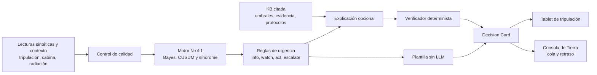

# LIGHTMINUTE: estado técnico y plan de evolución

**Corte:** 2026-11-14  
**Estado:** prototipo funcional para NASA Space Apps. Trabaja con datos sintéticos y datos públicos etiquetados como `proxy` o `real-public`. Es apoyo a la decisión para tripulación entrenada; no es un dispositivo médico ni emite diagnósticos.

## 1. Qué es el proyecto

LIGHTMINUTE ayuda a una tripulación en misiones con retraso de comunicaciones a identificar cambios respecto al patrón personal de cada integrante, comprender por qué importan y seguir un protocolo local o enviar un resumen a Tierra.

La idea central es que el motor determinista calcula niveles y urgencia. Un modelo de lenguaje puede redactar una explicación, pero no decide cifras ni urgencia. Si no hay red, clave de proveedor o respuesta válida del modelo, el sistema entrega una tarjeta de plantilla basada en el motor y la base de conocimiento.

## 2. Lenguajes y formatos usados

| Área | Lenguajes y formatos | Uso en el proyecto |
|---|---|---|
| Motor y API | Python 3.11+ | Motor estadístico, simulador, API FastAPI, validación, ingestión de datos y pruebas. El entorno revisado usó Python 3.12. |
| Tablet de tripulación | TypeScript estricto, React, TSX, CSS | Interfaz Glance → Why → Act, gráficos SVG, estado mediante URL hash y consumo de API o JSON local. |
| Consola de Tierra | JavaScript moderno, HTML, CSS, SVG | Consola estática, verificación de cadena de auditoría en navegador y visualización de mensajes retrasados. |
| Runner de protocolos | JavaScript, HTML, CSS | Componente reutilizable que puede montarse en React o abrirse como demo estática. |
| Datos y contratos | JSON, YAML | Escenarios, evidencia, umbrales, síndromes, protocolos, snapshots, manifiestos y resultados de validación. |
| Documentación | Markdown y Mermaid | Arquitectura, contrato de datos, modelo, validación, guía de demo y documentación de entrega. |
| Automatización | Make, Bash, GitHub Actions, npm, pip | Instalación, pruebas, lint, build y CI. |

## 3. Herramientas y tecnologías

| Capa | Tecnología | Papel |
|---|---|---|
| Modelo estadístico | NumPy, SciPy | Baseline bayesiano conjugado N-of-1, intervalos predictivos, CUSUM y fusión de señales. |
| Backend | FastAPI, Pydantic, Uvicorn, HTTPX | API tipada, validación de peticiones, servidor local y cliente HTTP. |
| Capa opcional de IA | DeepSeek `deepseek-flash`, cliente compatible con OpenAI | Redacta tarjetas explicativas bajo verificación. Puede desactivarse con `LLM_PROVIDER=none`. |
| Frontend | React 19, TypeScript 5.9, Vite 7 | Tablet web de la tripulación y compilación de producción. |
| Visualización | SVG hecho a medida | Gráficas de banda personal, sparklines, mapa corporal y estados de riesgo sin depender de una librería de charts. |
| Integridad | SHA-256 y Web Crypto/SubtleCrypto | Cadena de auditoría compatible entre Python y JavaScript. |
| Datos | JSON estático, snapshots con SHA-256, DuckDB disponible en dependencias | Escenarios reproducibles, modo sin red y trazabilidad de fuentes públicas. |
| Calidad | Pytest, Ruff, Mypy disponible, Node test runner, `node --check` | Pruebas del motor, auditoría de consola, análisis estático y chequeo de sintaxis. |
| CI | GitHub Actions | Pipeline para motor, red team, build de tablet y pruebas de la cadena de auditoría. |

## 4. Qué tenemos funcionando

### Motor de decisión

- Baseline personal N-of-1 por miembro de la tripulación con modelo Normal-Inverse-Gamma y predicción Student-t.
- Actualización robusta, CUSUM bilateral y score de síndrome direccional para detectar cambios coordinados.
- Tres lentes de interpretación: regla terrestre, regla adaptada al espacio cuando existe y patrón personal.
- Atribución de tripulación para diferenciar una señal individual de una exposición compartida.
- Control de calidad que descarta lecturas imposibles o ausentes antes de actualizar el baseline.
- Niveles `info`, `watch`, `act` y `escalate`, calculados por el motor, no por el LLM.

### Escenarios, conocimiento y datos

- Tripulación sintética de cuatro personas con seis indicadores: frecuencia cardiaca en reposo, temperatura, sueño, tiempo de reacción PVT, CO₂ y cefalea.
- Tres escenarios con variantes fuerte y suave: síndrome tipo fiebre del CMO, evento solar con pérdida de sueño y aumento progresivo de CO₂.
- Base de conocimiento con evidencia, umbrales, síndromes y tres protocolos sin dosis: fiebre, clúster CO₂/cefalea y ortostatismo post-EVA.
- Snapshot público de NOAA GOES para radiación, con manifiesto, hash y licencia.
- Proxy público MMASH etiquetado como proxy, no como datos de astronautas.

### API y tarjetas de decisión

- Endpoints de salud, catálogo de escenarios, escenario individual, tarjeta de decisión y estadísticas de LLM.
- Smoke real contra Uvicorn comprobó `/api/health`, `/api/scenarios`, `/api/scenario/cmo_fever` y `POST /api/card` con respuestas 200 usando `LLM_PROVIDER=none`.
- Fallback determinista de tarjetas cuando no se usa LLM.
- Verificador de esquema, campos permitidos, citas de KB, números del motor, longitud del mensaje a Tierra, lenguaje de diagnóstico y dosificación.
- Red team local: 30 de 30 tarjetas adversariales fueron rechazadas.

### Interfaces

- Tablet React con las vistas Glance, Why, Act, Radiation y Validation.
- Fallback a JSON estático cuando la API no está disponible.
- Selector de escenario, día y miembro de tripulación; modo presentación y estado compartible por URL hash.
- Consola de Tierra estática con niveles de los cuatro miembros, tendencias, mensajes retrasados, consentimiento y línea de tiempo ISS/Luna/Marte.
- Runner de protocolos de pasos grandes con temporizador, deshacer, ruta de “no puedo realizar este paso”, navegación por teclado y regiones ARIA.

### Validación y automatización

- Validación sintética con presupuestos de falsos avisos equivalentes, calibración de intervalos, datos faltantes y distinta longitud de baseline.
- En la corrida registrada, la cobertura agrupada de intervalos al 95% fue 95% en 11 040 indicador-días sintéticos. Estos resultados no representan validación clínica.
- Build de producción de la tablet correcto: 60 módulos y bundle principal de 293.81 kB, 91.85 kB gzip.
- Prueba de la cadena de auditoría de consola: 8 comprobaciones aprobadas, incluidas compatibilidad Python/JavaScript y detección de manipulación.
- Suite del motor fuera de las pruebas API: 67 pruebas aprobadas. El red team aporta 30 pruebas adicionales aprobadas.

## 5. Apartado visual: qué existe hoy

La dirección visual actual es una consola de misión calmada y legible, con modo oscuro predeterminado y modo claro. Evita el estilo de ciencia ficción recargado y prioriza lectura rápida durante una situación de posible estrés.

| Elemento visual | Estado actual | Aporte a la experiencia |
|---|---|---|
| Jerarquía | Glance → Why → Act | Primero muestra estado, luego evidencia y finalmente acciones. |
| Estados | Texto, icono y color | Evita comunicar urgencia solo por color y mejora accesibilidad para daltonismo. |
| Gráficas | Banda personal del 95%, punto actual, reglas y anotaciones | Hace visible la diferencia entre un valor poblacional aceptable y un cambio inusual para esa persona. |
| Navegación | Barra superior, selector de escenario, tripulación y día | Permite recorrer la demo sin perder el contexto del caso. |
| Diseño de datos | Tipografía tabular, bordes suaves, mucho espacio y un acento contenido | Mantiene una apariencia instrumental y reduce carga cognitiva. |
| Accesibilidad base | Enlace para saltar contenido, foco visible, etiquetas ARIA, navegación por teclado y respeto por reducción de movimiento | Da una base correcta para un entorno con guantes, poca luz o uso de teclado. |
| Modos degradados | Aviso de API sin conexión y tarjetas plantilla | La interfaz sigue explicando qué ocurre cuando no hay motor remoto ni LLM. |
| Protocolo | Botones grandes, un paso por pantalla, progreso y temporizador | Apoya la ejecución de una acción bajo presión. |

### Mejoras visuales recomendadas

1. Añadir el modo rojo para baja iluminación y validarlo con contraste real.
2. Crear una silueta corporal SVG propia que conecte cada región con riesgos e indicadores; debe tener atribución si usa una fuente externa.
3. Revisar tablet y consola a 1280×720 y 390×844, incluidos textos largos, estados sin datos y una alerta `escalate`.
4. Ejecutar una auditoría automática de accesibilidad, por ejemplo con axe, e incorporarla a CI.
5. Preparar seis capturas coherentes: Glance, Why, Act, radiación, validación y consola de Tierra.

## 6. Lo que falta o requiere corrección

| Prioridad | Pendiente | Motivo |
|---|---|---|
| Alta | Resolver el bloqueo de `TestClient` en las 10 pruebas API | La suite descubre 77 casos, pero la parte API se queda esperando en el transporte de pruebas instalado. El servidor Uvicorn funciona, pero la suite automatizada debe finalizar. |
| Alta | Corregir los 24 hallazgos de Ruff | El lint reporta imports, context managers, capturas de excepciones y estilo. 17 están marcados como autocorregibles. |
| Alta | Crear o corregir `apps/crew-tablet/scripts/smoke.mjs` | `npm run test:e2e` lo declara, pero el archivo no existe y el e2e no puede arrancar. |
| Alta | Hacer pública la evidencia de entrega | Para la presentación faltan capturas, vídeo de 60 segundos, equipo/roles, licencia física y confirmar visibilidad pública del repositorio según `docs/SUBMISSION.md`. |
| Media | Ensayar integración visual | Verificar en navegador tablet con API disponible, API caída, JSON estático, consola y demos `file://`. |
| Media | Revalidar snapshots | Ejecutar verificación de hash y conteo para NOAA, y confirmar trazabilidad del proxy MMASH. |
| Media | Probar el proveedor DeepSeek con una clave de prueba controlada | El flujo está implementado, pero no se ha probado una llamada real. Debe conservarse el fallback sin LLM. |
| Media | Revisión experta | Umbrales y pasos de protocolos necesitan revisión clínica/operativa antes de uso fuera de demo. |
| Baja | Completar pruebas de tipos | Mypy está disponible como dependencia de desarrollo, pero no forma parte de los comandos principales actuales. |

## 7. Ideas para mejorar el trabajo

### Mejoras que aumentan confiabilidad

- Fijar versiones compatibles de FastAPI, Starlette y su cliente de pruebas; después exigir en CI que los 77 tests terminen.
- Reemplazar el e2e ausente por un smoke de navegador que abra la tablet, cargue un escenario, cambie a Why y Act, y pruebe el fallback sin API.
- Añadir chequeo de accesibilidad, typecheck explícito y lint limpio a GitHub Actions.
- Añadir pruebas de contrato entre el JSON generado por el motor, la API y la tablet para evitar que la interfaz interprete campos obsoletos.
- Mostrar en cada vista la fecha, etiqueta y origen de la fuente (`synthetic`, `proxy` o `real-public`).

### Mejoras de producto para una demo más fuerte

- Convertir los tres escenarios en un recorrido guiado de 90 segundos con un estado inicial, cambio importante y acción final por caso.
- Asociar protocolos a los escenarios solo cuando una regla determinista los justifique; la selección no debe depender de texto generado.
- Añadir una pantalla breve de “calidad de señal” que explique sensores ausentes, baseline aún aprendiendo y confianza baja.
- Mejorar el mensaje a Tierra con una vista previa compacta, consentimiento elegido y hora estimada de respuesta.
- Añadir exportación local del resumen y de la cadena de auditoría como archivo, sin incluir datos personales reales.

### Ideas para una evolución posterior al hackathon

- Aplicar ingesta por lotes firmados y almacenamiento local cifrado, siempre con consentimiento por nivel de información.
- Incorporar check-in diario, PVT-B, autoinforme de síntomas y contexto de EVA, manteniendo el motor como fuente de urgencia.
- Añadir entrada por voz o visión como captura de información, con confirmación humana y sin sustituir reglas deterministas.
- Ampliar validación con fuentes públicas permitidas y claramente etiquetadas; reportar resultados, limitaciones y fallos sin llamarlos validación clínica.
- Diseñar sincronización diferida para misiones con comunicaciones intermitentes y varias tripulaciones, sin sacrificar el modo offline.

## 8. Orden recomendado de trabajo

1. Reparar la automatización: `TestClient`, e2e faltante y lint.
2. Hacer una pasada visual y de accesibilidad de los cinco estados clave de la tablet y la consola.
3. Preparar los recursos de presentación: capturas, demo grabada, roles y licencia.
4. Validar snapshots y, si se dispone de una clave, probar una llamada real al LLM manteniendo el fallback.
5. Solo después, ampliar funciones como voz, visión, sincronización o nuevos indicadores.

## 9. Límites que deben mantenerse

- El motor determinista decide números, niveles y urgencia; el LLM solo explica.
- La aplicación debe funcionar con `LLM_PROVIDER=none`.
- No se deben incorporar datos personales de salud reales al repositorio, prompts, logs o demo.
- Las fuentes deben identificarse como `synthetic`, `proxy` o `real-public`.
- No usar lenguaje de diagnóstico ni recomendaciones de dosis.
- Cada afirmación y umbral debe estar respaldado por la KB o marcado como `unverified`.

## Fuentes internas consultadas

- `README.md`
- `docs/ARCHITECTURE.md`
- `docs/DEMO_DATA_CONTRACT.md`
- `docs/SUBMISSION.md`
- `docs/reportes.md`
- Configuración de `services/engine`, `apps/crew-tablet`, `apps/ground-console` y `.github/workflows/ci.yml`
