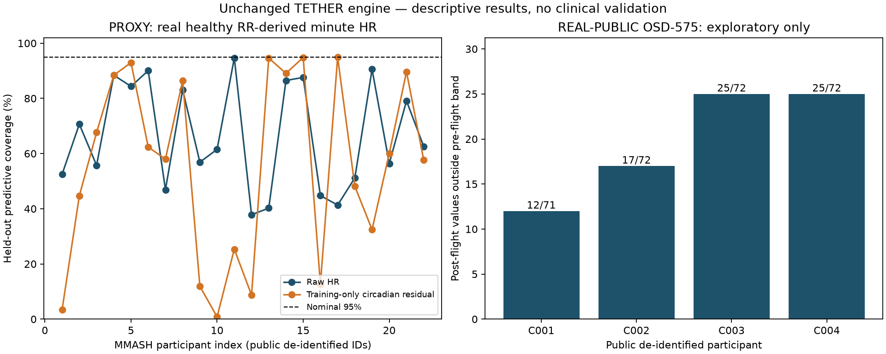

# Public-data validation

Two preregistered studies on the shipped Student-t predictor. Neither establishes
clinical sensitivity, and the MMASH calibration gate **fails** on the current
engine revision. Acquisition and scripts began on November 14, 2026; runs
finished on November 15 UTC, outside the original 90-minute wall-clock windows.

The engine changed after the first study (nine fault-injection fixes in
`05533ea`, including the FI-13 sustained-shift guard). V1 numbers describe the
pre-fix engine and are preserved under `archive-pre-fix/`; v2 numbers describe
the code at repository revision `6deea70` and are the ones to quote. V1 results
were known before the v2 registration (`PREREG-MMASH-v2.md`), so v2 is a
confirmation on a revised engine, not a blinded replication.

Counts and predictions are in [the run output](credibility-run.log) and [the
detailed JSON](credibility-results.json).

## MMASH · healthy terrestrial proxy

PhysioNet MMASH v1.0.0, Rossi et al., is open under the Open Data Commons Open
Database License v1.0. Retain attribution and the dataset license when reusing
the database. The archive digest matched PhysioNet's SHA-256 release manifest.
This run converts positive finite RR intervals in seconds to beats/minute, takes
minute medians and scores before updating. Across 22 participants there were
5,859 training and 23,488 held-out occupied minutes. Missing minutes within the
recording spans totalled 1,318. [Dataset and data dictionary](https://physionet.org/content/mmash/1.0.0/)
· [Release digests](https://physionet.org/files/mmash/1.0.0/SHA256SUMS.txt)

| Engine revision | Model input | Held-out observations inside nominal 95% band | Outside-band minutes per observed person-day | Median participant band width (bpm) |
|---|---|---:|---:|---:|
| `6deea70` (v2, shipped) | Raw minute HR | 15,590/23,488 (**66.37%**) | 484.21 | 28.69 |
| `6deea70` (v2, shipped) | Residual after training-only clock adjustment | 13,197/23,488 (**56.19%**) | 630.92 | 33.56 |
| `e0c1fb5` (v1, pre-fix) | Raw minute HR | 21,879/23,488 (93.15%) | 98.64 | 29.53 |
| `e0c1fb5` (v1, pre-fix) | Residual after training-only clock adjustment | 22,320/23,488 (95.03%) | 71.61 | 35.74 |

**The v2 calibration gate fails.** The preregistered tolerance was 90–98 %
pooled coverage. Both v2 inputs fall far below it, and individual raw coverage
ranges from 37.83 % to 94.67 % (adjusted 0.82 % to 94.93 %). The cause is the
FI-13 guard: three consecutive departures beyond the predictive band freeze the
baseline until an operator re-baselines, and ordinary circadian drift trips that
condition in healthy recordings. The frozen mean then sits away from the actual
level, producing persistent out-of-band flags. This is a real regression, not a
harness failure, and it is a blocker for shipping the guard as implemented.

The clock adjustment again fails the preregistered helpfulness rule: absolute
distance from 95 % does not decrease and band width grows. Positive serial
correlation means adjacent flags can describe the same episode; flags per day
are not independent alarms. Missing minutes were never filled. The data have no
labelled disease events, and the single partial-day training period cannot
establish a circadian rhythm or validate Gaussian assumptions. No parameter was
changed after seeing v2; the preregistration forbids it.

## OSD-575 · real-public Inspiration4 serum chemistry

The unrestricted transformed CMP CSV was linked to the sample metadata using the
exact sample key. Unit-bearing indicator columns and explicit phase, relative-day
and subject metadata defined eligibility. Baselines were initialized and updated
only on preflight values, then frozen. The public study page lists CC0-1.0.
[NASA OSDR study](https://osdr.nasa.gov/bio/repo/data/studies/OSD-575) · [API documentation](https://visualization.osdr.nasa.gov/biodata/api/)

| Measure | Result |
|---|---:|
| De-identified participants / rows in source table | 4 / 28 |
| Indicator columns / eligible subject–indicator histories | 19 / 72 |
| Preflight samples per included history | 3 |
| Postflight predictions outside preflight predictive band | 79 / 287 |
| Postflight observations scored at R+1 / R+45 / R+82 / R+194 | 72 / 71 / 72 / 72 |

The transformed CMP and visit metadata include R+194, beyond the abbreviated
study description. The primary kidney study also documents this visit. The JSON
reports the direction, units, band, missingness and visit for each eligible
measurement. Differences may reflect small baseline samples, within-person
variability, collection conditions or flight. Multiple indicators and visits
belong to the same people.

**Directional concordance with the literature is NOT DONE.** The follow-up
registration (`PREREG-OSDR-DIRECTION.md`) requires freezing the published
signs before inspecting new numerical results. The CMP values were already
inspected during v1, so that ordering can no longer be guaranteed in this cycle.
No concordance claim is made, and the JSON records the same status.

## Reproduction

From the project root use Python 3.14.3 and the [pinned analysis dependencies](credibility-requirements.txt).
Obtain the [MMASH archive](https://physionet.org/files/mmash/1.0.0/MMASH.zip) in
`data/snapshots/MMASH.zip`. Run `python ml/proxy/credibility_fetch.py` to
retrieve the public metadata and unrestricted CMP (network), then
`python ml/proxy/credibility_analysis.py` (offline). [Acquisition
manifest](credibility-provenance.json) records the URLs, timestamps and hashes.
Archive SHA-256 is `ef91ee1b36b5849a6366b1918de82686ab278915d33c7f62133f07f741f70726`.
CMP SHA-256 is `5eb1e7f025dd8443a9e70111e62bc32afae3432753024489c5c013e401d709d9`.
Source-engine hash, exclusions and per-participant metrics are in the detailed
JSON; the v1 outputs are in `archive-pre-fix/`.
