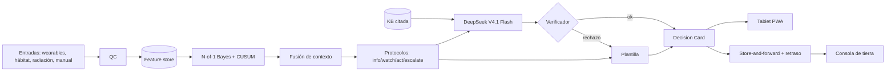

# Arquitectura general
Tres niveles: **Núcleo a bordo** (determinista, offline) → **Explicación** (LLM + verificador, opcional) → **Enlace a tierra** (diferido, con consentimiento).

Detalle y contratos: `docs/ARCHITECTURE.md` del repo. Decisiones: [[ADR-001 Motor decide LLM explica]] · [[ADR-002 N-of-1 conjugado]] · [[ADR-003 Cache-stuffing de la KB]] · [[ADR-004 Stack]].

Relacionado: [[00-Home]].
